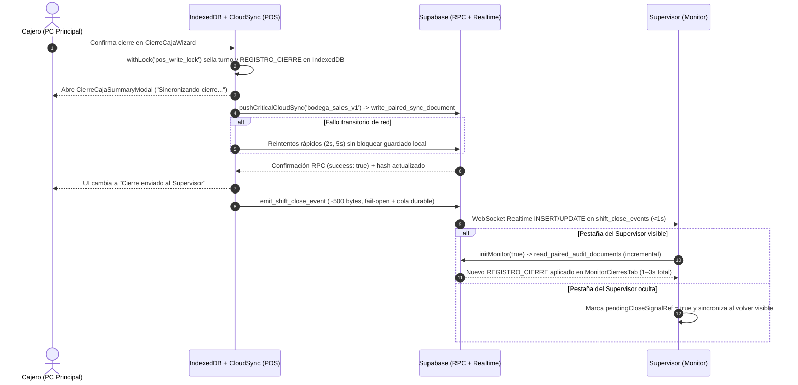

# Plan Maestro — Sincronización Garantizada y en Tiempo Real del Cierre de Caja hacia el Supervisor

> **Fecha:** 2026-11-21  
> **Versión base:** `v1.1.8` (`package.json`)  
> **Dispositivo central de producción (`.agents/AGENTS.md`):** `PDA-V2-ED46F23C375734BF8DF4CC7DC4A4D39F`  
> **Proyecto Supabase Cloud/Sync:** `kcananrtcmckovdstvao.supabase.co`  
> **Estado:** Implementado (Fase 0 + Fase 1 + Fase 2A aplicada en Supabase + Fase 2B en PWA)  
> **Revisión v6 (2026-11-21):** incorpora auditoría de v5: backoff dedicado `close_signal:<deviceId>` + single-flight + fast-path O(1) en `flushPendingCloseSignals`, reintentos cortos solo en emisión inmediata, evento reactivo `close_signal_queue_changed`, filtro estricto por `deviceId`, exclusión `cierre_id <> p_cierre_id` en el rate-limit SQL, declaración de `pendingCloseSignalRowRef`, extracción explícita de `registroCierre` en `force_daily_close`, y dependencia explícita Fase 2B sobre Fase 1. Los cambios están marcados con **[v2]**–**[v6]**.  
> **Revisión v7 (2026-11-21):** incorpora auditoría de v6: skip local en `INSERT` y `UPDATE` (y corrección de la justificación de egress: el pull es incremental), marcadores `POS_SYNC_DEVICE_NOT_REGISTERED` en el RPC, sin normalización de `PGRST202`, helper `setCloudRetryCooldown` en `cloudRetry.js`, reintento manual que ignora cooldowns no permanentes, encolado en la rama `alreadyApplied` de `force_daily_close`, fast-path por string crudo en lugar de caché en memoria, y aclaración de `registroCierre` en `force_daily_close`. Marcado **[v7]**.  
> **Revisión v8 (2026-11-21):** incorpora re-auditoría completa de v7: verificación de que el `cierreId` viaja realmente en el payload subido (`uploadedCierreIds` + `reason: 'merge_vetoed'`) para evitar un falso "synced" cuando el merge se veta, extracción de ids desde `value` en el retorno temprano `unchanged` con fast-path previo, bloqueo/confirmación de F5/Ctrl+R en Electron durante la subida crítica, tratamiento del apagado de Windows, toast del Supervisor emitido al completar el pull y corrección del principio 4. Marcado **[v8]**.  
> **Cierre de implementación (2026-11-21):** la carpeta `desktop/` (Electron) fue retirada del repo por decisión de producto (solo se usa PWA en Vercel). Se incorporaron además las correcciones de la auditoría post-implementación: aborto de subidas ordinarias obsoletas en cola (`activeOrdinaryPushControllers`) para garantizar el límite de 90 s de `pushCriticalCloudSync`, `immediate: true` en `flushPendingCloseSignals` ignorando cooldowns transitorios previos (respetando `rate_limited` y permanentes), eliminación del parpadeo de `"Aviso pendiente"` durante el flush inmediato, y prueba de integración completa de `DashboardView` (`tests/dashboardCloseIntegration.test.jsx`).  
> **Alcance de la auditoría:** Revisión estática completa sobre código fuente, configuración Electron y scripts SQL del repositorio (no se ejecutaron consultas en vivo contra la base de datos de producción por ausencia de token MCP).

---

## 1. Diagnóstico de Causas Raíz (Verificadas en Código)

Cuando la caja realiza un cierre en la PC principal (`DashboardView`), el Supervisor (`OwnerMonitorView`) a veces no lo recibe en ese turno y solo lo visualiza al día siguiente al volver a abrir la caja. Este comportamiento se origina por la combinación de cinco causas verificadas en el código:

| ID | Severidad | Componente | Causa raíz verificada | Ubicación exacta |
|---|---|---|---|---|
| **H1** | 🔴 Crítico | PC Principal (POS) | Cierre *fire-and-forget*: confirma "Cierre Completado" en <100 ms tras guardar en `IndexedDB`, encolando la subida a la nube sin `await`, sin feedback de envío ni protección contra cierre de ventana/app/PC. | `src/views/DashboardView.jsx` (`handleConfirmCashRecon`, líneas 497–515)<br>`src/utils/storageService.js` (líneas 153–162)<br>`src/hooks/useCloudSync.js` (líneas 125–134, 352, 614)<br>`src/components/SyncStatus.jsx` (líneas 10–47)<br>`desktop/main.js` (líneas 54–74) |
| **H2** | 🟠 Alto | PC Principal (Cola Cloud) | *Cooldown* heredado de errores previos (15 s → 30 min), reintento automático solo cada 60 s, cola serializada (`serializedCloudPush`) y doble transferencia (~4.6 MB descarga + ~4.6 MB subida) cuando `dj_sales_push_merge_v1` está activo. | `src/hooks/useCloudSync.js` (líneas 89, 180–183, 227–257, 379–384, 761–762)<br>`src/utils/cloudRetry.js` (líneas 2–5) |
| **H3** | 🟠 Alto | Nube + Supervisor | El Supervisor no recibe `bodega_sales_v1` por Realtime: `sync_documents` tiene `SELECT` revocado para `anon`, el payload (~4.6 MB) excede el límite de Realtime (~1 MB / 413), eventos truncados en segundo plano se ignoran y el *catch-up* sano corre cada 3 min solo en primer plano. | `supabase_remote_audit_setup.sql` (líneas 342–345)<br>`supabase_rls_hardening.sql` (líneas 47–52)<br>`src/hooks/useMonitorSync.js` (líneas 24–36, 520–563, 713) |
| **H4** | 🟡 Medio | PC Principal + Nube | Crecimiento continuo de `bodega_sales_v1` hacia el límite duro de 8 MB (`SALES_ARCHIVE_ENABLED = false`), aumentando el tiempo de subida (8–40 s+) y la probabilidad de aborto al apagar la PC o rechazo definitivo al cruzar 8 MB. | `src/hooks/useCloudSync.js` (líneas 56, 285–300)<br>`supabase_remote_audit_setup.sql` (líneas 265–267) |
| **H5** | 🟡 Medio | PC Principal (Estado React) | Asimetría entre abrir el asistente (`hasShiftMovements \|\| hasTodayMovements`) y crear `REGISTRO_CIERRE` (`if (summaryObj)` dependiente de `shiftCashFlow.length > 0` en React) al persistir bajo `withLock`. | `src/views/DashboardView.jsx` (líneas 411–426, 454–495) |

### Detalle de cada hallazgo

1. **H1 🔴 — Cierre *fire-and-forget* y llegada al día siguiente:**
   - En `src/views/DashboardView.jsx` (`handleConfirmCashRecon`, líneas 497–515), tras escribir `bodega_sales_v1` en `IndexedDB` vía `storageService.setItem`, `notifyPersisted` (`src/utils/storageService.js:153-162`) invoca `queueCloudSync('bodega_sales_v1', freshUpdated)`, que solo programa `_debouncePush` (`setTimeout(..., 300)` en `src/hooks/useCloudSync.js:125-134`) llamando a `pushCloudSync(...).catch(() => {})` sin `await`.
   - En contraste, el cierre remoto (`force_daily_close` en `src/hooks/useSupervisorCommands.js:1176`) sí hace `await pushCloudSync('bodega_sales_v1', result.updatedSales)`.
   - `CierreCajaSummaryModal` se abre inmediatamente mostrando **"Cierre Completado"** mientras la subida de `bodega_sales_v1` (~4.6 MB) apenas va a comenzar o sigue en tránsito.
   - Ni `useCloudSync.js` ni `desktop/main.js` (líneas 54–74) bloquean o advierten al cerrar la pestaña/aplicación Electron durante una subida de cierre, y `SyncStatus.jsx` solo refleja `navigator.onLine`.
   - Si la petición HTTP se interrumpe al cerrar el programa o apagar la PC, `pushCloudSyncNow` nunca guarda el hash en `bodega_last_periodic_push_hash_bodega_sales_v1` (`useCloudSync.js:352`). Al día siguiente, al iniciar la app, `initSync()` llama `forceSyncAllPOSData(deviceId, false)` (`useCloudSync.js:614`), detecta el hash pendiente y sube recién entonces el cierre del día anterior (o al registrar la nueva `APERTURA_CAJA`).

2. **H2 🟠 — *Cooldown* heredado, cola bloqueada y doble transferencia:**
   - Si una venta previa tuvo un fallo de red o timeout, `pushCloudSyncNow` entra en *cooldown* (`sync:<deviceId>:bodega_sales_v1` en `useCloudSync.js:180-183`, ventana de 15 s hasta 30 min en `src/utils/cloudRetry.js:2-5`) y descarta silenciosamente el push del cierre.
   - Sin un disparador dedicado, el siguiente intento automático solo ocurre en el intervalo de 60 s (`setInterval(forcePushLocalData, 60000)`, `useCloudSync.js:762`).
   - `serializedCloudPush` (`useCloudSync.js:89, 379-384`) encola el cierre detrás de cualquier envío previo aún en vuelo de `bodega_sales_v1`.
   - En producción (`PDA-V2-ED46F23C375734BF8DF4CC7DC4A4D39F`), cuando `dj_sales_push_merge_v1 === 'true'` (según `.agents/AGENTS.md` §9), `pushCloudSyncNow` (`useCloudSync.js:227-257`) descarga primero el snapshot remoto (~4.6 MB) vía `fetchCloudSalesReference` antes de subir ~4.6 MB; si esa lectura falla, la línea 240 aborta y pospone el push hasta el próximo ciclo.

3. **H3 🟠 — Supervisor ciego al cierre en tiempo real:**
   - `REVOKE SELECT ON public.sync_documents FROM anon` (`supabase_remote_audit_setup.sql:344-345`, `supabase_rls_hardening.sql:49-51`) impide que Realtime entregue filas de `sync_documents` al rol `anon` con el que opera el Monitor.
   - Adicionalmente, `bodega_sales_v1` (~4.6 MB) supera el límite de payload de Realtime (~1 MB / error 413) y si la pestaña del Supervisor está oculta (`hiddenRef.current`), `useMonitorSync.js` (líneas 538 y 713) omite la descarga diferida.
   - Con el canal sano, el *catch-up* incremental corre cada 3 minutos (`MONITOR_HEALTHY_PULL_INTERVAL_MS = 3 * 60 * 1000`, `useMonitorSync.js:24`, commit `5742404`).

4. **H4 🟡 — Tope duro de 8 MB y latencia creciente:**
   - Como `SALES_ARCHIVE_ENABLED = false` (`useCloudSync.js:56`), todo el histórico viaja sin compactar en cada escritura de `bodega_sales_v1`, acercándose al límite de 8 MB tanto en cliente (`MAX_DOC_BYTES = 8 * 1024 * 1024`, `useCloudSync.js:285-300`) como en el RPC (`octet_length(p_data::text) > 8388608`, `supabase_remote_audit_setup.sql:265`).

5. **H5 🟡 — Condición asimétrica al construir `REGISTRO_CIERRE`:**
   - `handleDailyClose` (`DashboardView.jsx:411-412`) habilita el wizard si `hasShiftMovements || hasTodayMovements`, mientras `handleConfirmCashRecon` (`DashboardView.jsx:426, 455`) solo crea `registroCierre` si `shiftCashFlow.length > 0` en el estado React. Si `freshSales` bajo `withLock` contiene movimientos abiertos cuando `shiftCashFlow` en memoria estaba vacío o desactualizado, podría marcar registros como `cajaCerrada: true` sin insertar `REGISTRO_CIERRE`.

---

## 2. Arquitectura Objetivo (Entrega en 1–3 Segundos)



### Principios de Diseño

1. **Offline-First intacto:** El cierre de caja se persiste primero y siempre en `IndexedDB` bajo `withLock('pos_write_lock')`. Si no hay internet, el cierre local **nunca falla ni se pierde**; queda marcado claramente como pendiente de envío para el cajero y se reintenta al reconectar o en el arranque.
2. **Seguridad sin regresiones:** `sync_documents` permanece cerrado (`REVOKE ALL ... FROM anon`). Toda lectura y escritura de documentos sigue pasando exclusivamente por `write_paired_sync_document` y `read_paired_audit_documents`.
3. **Señal liviana posterior al commit cloud:** El evento Realtime (`shift_close_events`, <500 bytes) se emite **únicamente después** de que `write_paired_sync_document` confirmó la persistencia de `bodega_sales_v1` en Supabase, evitando que el Supervisor haga un pull vacío antes de que los datos existan en la nube.
4. **Cero impacto negativo en egress:** La señal se dispara una vez por cierre de caja (~500 bytes) y **[v8] complementa** el polling de 3 min (que se conserva como respaldo, ver §4.5) con un pull incremental puntual solo cuando ocurre un cierre real.

---

## 3. Plan de Implementación por Fases (`1 fase = 1 commit`)

Orden estricto de ejecución: **Fase 0 → Fase 1 → Fase 2A (SQL) → Fase 2B → Fase 2C (Opcional) → Fase 3 (Mediano plazo)**.

> **[v6] Dependencia de commits:** **Fase 2B parte obligatoriamente sobre Fase 1 ya integrada**, ya que ambas intervienen los mismos puntos de `src/views/DashboardView.jsx` (`syncLatestCloseToCloud`), `src/components/Dashboard/CierreCajaSummaryModal.jsx` y `src/hooks/useCloudSync.js` (`pushCloudSyncNow`). Fase 2A (SQL) debe ejecutarse en Supabase antes de activar/desplegar Fase 2B.

---

### Fase 0 — Blindaje de creación de `REGISTRO_CIERRE` (H5)

- **Archivo a modificar:** `src/views/DashboardView.jsx`
- **Objetivo:** Garantizar que ningún cierre de turno con movimientos abiertos en `IndexedDB` termine marcando `cajaCerrada: true` sin su correspondiente objeto `REGISTRO_CIERRE`.
- **Cambios exactos:**
  1. Dentro del callback de `withLock('pos_write_lock', ...)` en `handleConfirmCashRecon`, evaluar `freshShiftScope = getOpenShiftMovements(freshSales)`.
  2. **[v3] Alineación con `shiftScope.js` y creación determinista de `REGISTRO_CIERRE`:** En `src/utils/shiftScope.js:9`, `APERTURA_CAJA` forma parte de `TIPOS_CIERRE`, por lo que `freshShiftScope.movements` ya incluye la apertura activa (`apertura`). Si `freshShiftScope.movements.length > 0 || freshShiftScope.orphans.length > 0`, se construye/recalcula siempre el `registroCierre` (aun cuando `summaryObj` en React estuviera vacío o desfasado), manteniendo el comportamiento actual de producción para turnos solo-apertura (dejar constancia en `REGISTRO_CIERRE` del arqueo del fondo inicial aunque haya \$0.00 en ventas).
  3. Mantener el cálculo de `cierreNumber` desde `freshSales` bajo el mismo `withLock`.
  4. **[v2]** Los totales de `registroCierre.summary` (`todayTotalUsd`, `todayTotalBs`, `todayProfit`, `todayItemsSold`) se recalculan **siempre** desde `freshShiftScope` usando `dinero.js` (`round2`, `sumR`) y `FinancialEngine.calculateAggregateProfit` / `FinancialEngine.calculatePaymentBreakdown` (y actualizan `summaryObj` antes de mostrar `CierreCajaSummaryModal` si `summaryObj` venía nulo).
  5. **[v2]** El callback de `withLock` devuelve `{ updatedSales, registroCierre }` para que Fase 1/2B reciban el registro directamente sin buscarlo después (respaldo: `updatedSales.find(s => s.tipo === 'REGISTRO_CIERRE' && s.cierreId === currentCierreId)`).
- **Verificación:** Prueba unitaria/integración de `handleConfirmCashRecon` simulando `shiftCashFlow` vacío o desactualizado en estado React con movimientos abiertos frescos en `storageService`, más el caso de turno solo-apertura.

---

### Fase 1 (Capa 1 — SIN SQL, despliegue inmediato) — Subida garantizada, feedback visual y protección de cierre en PC Principal

- **Objetivo:** Eliminar el ~90% de los casos donde el cierre no sube hasta el día siguiente, sin requerir migraciones SQL previas.
- **Archivos a modificar:**
  - `src/hooks/useCloudSync.js`
  - `src/utils/salesPushMerge.js`
  - `src/views/DashboardView.jsx`
  - `src/components/Dashboard/CierreCajaSummaryModal.jsx`
  - `src/components/SyncStatus.jsx`
  - `desktop/preload.js`
  - `desktop/main.js`
- **Archivo nuevo de pruebas:**
  - `tests/cierreCloudSync.test.js`

#### Detalle por archivo

1. **`src/hooks/useCloudSync.js` (y `src/utils/salesPushMerge.js`)**
   - **[v2] Contrato de resultado:** refactorizar `pushCloudSyncNow` para que internamente devuelva `{ ok: boolean, reason: string, retryable: boolean }` (`reason` ∈ `monitor`, `not_active`, `syncing_from_cloud`, `cooldown`, `circuit_breaker`, `too_large`, `merge_reference_unavailable`, `rpc_error`, `transport`, `aborted`, `ok`, `unchanged`). Exportar `pushCloudSyncDetailed(key, value, force = false, { signal } = {})` sobre la misma cola serializada. `pushCloudSync` sigue devolviendo `boolean` (`result.ok`) para no romper a ningún llamador existente. **[v8]** Para `key === 'bodega_sales_v1'`, el resultado detallado incluye además `uploadedCierreIds: string[]` con los `cierreId` de los `REGISTRO_CIERRE` presentes en el payload **realmente subido** (o confirmado como `unchanged`). Motivo: con el merge activo, si `prepareSalesPushPayload` veta la fusión por "merge encogió el array", devuelve la referencia cloud intacta (`src/utils/salesPushMerge.js:306-313`) y `pushCloudSyncNow` la sube con éxito (`useCloudSync.js:248-252`) **sin** el cierre nuevo. **[v5]** El wrapper `pushCriticalCloudSync` devuelve `{ ok: boolean, reason: string }` con los mismos valores de `reason` más `'timeout'`: `pushCloudSyncNow` siempre reporta `'aborted'` cuando `signal?.aborted`, y `pushCriticalCloudSync` traduce `'aborted'` originado por su temporizador `timeoutMs` (90 s) a `reason: 'timeout'`.
   - **[v2] Solo `retryable: true` se reintenta** (`rpc_error` no permanente y `transport`). `circuit_breaker`, `too_large`, `merge_reference_unavailable`, `aborted`, errores permanentes (`401/403/404/42P01/...`) y `monitor/not_active` **no** se reintentan: se reportan de inmediato como `failed` con mensaje claro. Esto evita repetir la descarga de ~4.6 MB del merge en cada reintento.
   - **[v4] Aborto propio sin cooldown global y aislamiento de `fetchCloudSalesReference`:**
     - En `pushCloudSyncNow`, si `signal?.aborted` es `true` (antes del RPC, tras `fetchCloudSalesReference` o en `catch`), retornar `{ ok: false, reason: 'aborted', retryable: false }` **sin** invocar `recordCloudRetryFailure`, para que un timeout propio nunca deje un cooldown global de hasta 60 s bloqueando el reintento automático siguiente.
     - En `src/utils/salesPushMerge.js`, cuando `fetchCloudSalesReference(deviceId, client, { fresh, signal })` recibe `signal`, debe ejecutar una petición aislada (sin leer ni escribir `_inFlightRefs`) para que abortar el push del cierre nunca cancele a otros llamadores concurrentes (`saleNumberAllocator`, `useSupervisorCommands`). Además, inmediatamente después de `await fetchCloudSalesReference(...)` en `pushCloudSyncNow`, comprobar `if (signal?.aborted)` **antes** de verificar `!Array.isArray(cloudReference)` para reportar `aborted` (traducido a `timeout` por `pushCriticalCloudSync` si venció su timer) en lugar de `merge_reference_unavailable`.
   - **[v3] Timeout total con `AbortController` real (`90 s`):** `pushCriticalCloudSync` crea un `AbortController` con temporizador total de 90 s (marcando `timedOut = true` al vencer) y pasa `signal` a `pushCloudSyncDetailed(key, value, false, { signal })`. Dentro de `pushCloudSyncNow` se propaga `.abortSignal(signal)` tanto a `supabaseCloud.rpc('write_paired_sync_document', ...)` como a `fetchCloudSalesReference(..., { fresh, signal })`. Así el aborto cancela de verdad el `fetch` en vuelo y libera la cola `serializedCloudPush` (de lo contrario un `Promise.race` dejaría la cola bloqueada incluso para el reintento manual). Al vencer el timeout: `pushCriticalCloudSync` traduce el `'aborted'` resultante a `{ ok: false, reason: 'timeout' }`, decrementa `criticalPushCount` y emite el evento `failed`; el cierre local queda intacto y el reintento automático normal (60 s) y el manual siguen disponibles.
   - **[v3] Cooldowns (sin borrar fallos recién registrados):** antes de limpiar los cooldowns transitorios (`sync:<deviceId>:<key>` y `sync:<deviceId>`), se guarda el `nextRetryAt` previo de `sync:<deviceId>` (si existía). Si los intentos fallan, `pushCloudSyncNow` habrá registrado su propio cooldown actualizado; se conserva el mayor `nextRetryAt` entre el previo (si había) y el recién registrado (y **nunca** se borra el cooldown recién creado si el previo era `null`). Máximo 3 intentos en total.
   - Exportar `cancelPendingPush(key)` para cancelar inmediatamente cualquier `setTimeout` pendiente en `pendingPush[key]` (evitando el retardo de debounce o una segunda subida redundante).
   - Exportar `hasCriticalCloudPushInFlight()` leyendo un contador de módulo (`criticalPushCount > 0`).
   - Implementar y exportar `pushCriticalCloudSync(key, value, { maxRetries = 2, retryDelaysMs = [2000, 5000], timeoutMs = 90000, expectedCierreId = null } = {})`:
     1. Llama `cancelPendingPush(key)`.
     2. Consulta `getCloudRetryState(...)` para `sync:<deviceId>:<key>` y `sync:<deviceId>`; guarda snapshot del estado previo global (`previousGlobalRetry`) y, si algún estado existe y **no es permanente** (`!state.permanent`), limpia el cooldown transitorio con `clearCloudRetryFailure(...)` para que un fallo previo en una venta no bloquee el cierre.
     3. Crea el `AbortController` con límite `timeoutMs` (bandera `timedOut`), incrementa `criticalPushCount` y emite `window.dispatchEvent(new CustomEvent('cloud_critical_sync_state', { detail: { busy: true, key, status: 'syncing' } }))`.
     4. **[v3]** Ejecuta `const result = await pushCloudSyncDetailed(key, value, false, { signal })` dentro de la cola serializada existente; si `!result.ok && result.retryable === true` y el timeout/abort no venció, reintenta hasta `maxRetries` veces esperando `retryDelaysMs[attempt]` (2 s y 5 s), limpiando cooldown transitorio entre intentos rápidos. Si `!result.ok`, asegura la regla de conservación del cooldown global máximo (`previousGlobalRetry` vs recién registrado). Si `timedOut` es `true` y `result.reason === 'aborted'`, normaliza `reason` a `'timeout'`. **[v8] Verificación de contenido:** si `result.ok === true` pero el `cierreId` esperado (parámetro `expectedCierreId` de `pushCriticalCloudSync`) **no** está en `result.uploadedCierreIds`, se trata como fallo: `{ ok: false, reason: 'merge_vetoed' }` (no reintentable de forma inmediata), para que la UI muestre `failed` con el botón de reintento en lugar de un falso "Cierre enviado". El reintento manual y el ciclo de 60 s siguen disponibles.
     5. En `finally`, limpia el timer del timeout, decrementa `criticalPushCount` y emite `cloud_critical_sync_state` con `busy: criticalPushCount > 0`, `status: result?.ok ? 'synced' : 'failed'`.
     6. Retorna `{ ok: boolean, reason: string }`.
   - **[v2] `beforeunload` solo en navegador/PWA** (`!window.electronAPI?.isElectron`): en Electron `preventDefault()` en `beforeunload` bloquea el cierre sin mostrar diálogo y, tras elegir "Salir de todas formas", volvería a bloquearlo en silencio. En Electron la protección la da únicamente el diálogo del proceso main (ver punto 5).
     ```js
     const handleBeforeUnload = (e) => {
         if (hasCriticalCloudPushInFlight()) {
             e.preventDefault();
             e.returnValue = '';
         }
     };
     ```
     registrarlo solo en navegador y removerlo en el cleanup.

2. **`src/views/DashboardView.jsx`**
   - Agregar estado local:
     - `const [cierreSyncStatus, setCierreSyncStatus] = useState('idle');` (`'idle' | 'syncing' | 'synced' | 'failed'`)
     - `const [cierreSyncError, setCierreSyncError] = useState(null);`
     - `const lastClosedSalesSnapshotRef = useRef(null);`
   - Extraer helper `syncLatestCloseToCloud(salesSnapshot)`:
     - Marca `setCierreSyncStatus('syncing')`, `setCierreSyncError(null)` y notifica a Electron `window.electronAPI?.setCriticalSyncBusy?.(true)`.
     - Llama `const result = await pushCriticalCloudSync('bodega_sales_v1', salesSnapshot, { expectedCierreId: registroCierre?.cierreId });` **[v8]** (si no hubo `REGISTRO_CIERRE`, se omite la verificación).
     - Actualiza `cierreSyncStatus` a `'synced'` o `'failed'` (guardando mensaje amigable en `cierreSyncError`) y limpia `window.electronAPI?.setCriticalSyncBusy?.(false)`.
     - Retorna `{ ok: result?.ok === true, registroCierre }` para encadenar Fase 2B limpiamente.
   - En `handleConfirmCashRecon`:
     - Guarda `lastClosedSalesSnapshotRef.current = updatedSales`.
     - Tras cerrar el wizard y abrir `CierreCajaSummaryModal`, invoca `syncLatestCloseToCloud(updatedSales)` sin bloquear la persistencia local ya confirmada.
   - Exponer `handleRetryCierreSync` que relee `storageService.getItem(SALES_KEY, [])` (o usa `lastClosedSalesSnapshotRef.current`) y re-ejecuta `syncLatestCloseToCloud`.

3. **`src/components/Dashboard/CierreCajaSummaryModal.jsx`**
   - Añadir props opcionales (100% retrocompatibles con callers/tests actuales):
     - `syncStatus = 'idle'`
     - `syncError = null`
     - `onRetrySync = null`
   - Renderizar un banner de estado de sincronización encima del bloque de acciones:
     - **`syncing`:** Spinner animado + `"Sincronizando cierre con el Supervisor... No cierres el programa todavía."`
     - **`synced`:** Check verde + `"Cierre enviado y confirmado en la nube para el Supervisor."`
     - **`failed`:** Alerta ámbar + `"Cierre guardado en esta PC, pero no se pudo enviar al Supervisor aún."` + detalle breve (`syncError` si existe) + botón `"Reintentar envío ahora"` (`onRetrySync`).
   - Si el operador pulsa cerrar el modal mientras `syncStatus === 'syncing'`, mostrar un aviso breve de confirmación (o advertencia clara de que seguirá subiendo en segundo plano visible en `SyncStatus`) sin atrapar al usuario si no hay internet.

4. **`src/components/SyncStatus.jsx`**
   - Escuchar `window.addEventListener('cloud_critical_sync_state', ...)`.
   - Mientras `busy === true`, mostrar una pastilla ámbar/azul animada `"Subiendo cierre..."` junto o sobre el estado Online/Offline para mantener visibilidad incluso si se minimizó `CierreCajaSummaryModal`.

5. **`desktop/preload.js` y `desktop/main.js`**
   - `desktop/preload.js`: importar `ipcRenderer` de `'electron'` y exponer `setCriticalSyncBusy: (busy) => ipcRenderer.send('critical-sync-busy', Boolean(busy))` dentro de `contextBridge.exposeInMainWorld('electronAPI', ...)`.
   - `desktop/main.js`: mantener `let criticalSyncBusy = false;`, escuchar `ipcMain.on('critical-sync-busy', (_event, busy) => { criticalSyncBusy = Boolean(busy); })` y resetear en `closed`.
   - **[v2]** Resetear también `criticalSyncBusy = false` en `webContents.on('did-start-navigation')` (F5/recarga) y `render-process-gone`, para que no quede pegado en `true`.
   - **[v2]** Registrar `mainWindow.webContents.on('will-prevent-unload', (e) => e.preventDefault())` para que, si el usuario elige "Salir de todas formas", ningún `beforeunload` residual del renderer vuelva a bloquear el cierre. Al elegir salir, main pone `criticalSyncBusy = false` antes de cerrar.
   - **[v8] Recarga F5/Ctrl+R:** el handler `before-input-event` de `desktop/main.js:45-51` llama `mainWindow.reload()` sin pasar por el diálogo de cierre y, en Electron, no hay `beforeunload`. Mientras `criticalSyncBusy === true`, mostrar el mismo diálogo de confirmación antes de recargar (o ignorar la tecla). Impacto acotado si no se hiciera (al recargar, `initSync` vuelve a subir y la cola durable conserva la señal), pero el arreglo es trivial.
   - **[v8] Apagado de Windows:** un `showMessageBoxSync` durante el apagado del sistema no es fiable. Evaluar en Electron 33 el evento de fin de sesión de Windows (`query-session-end` en `BrowserWindow`) para indicar el motivo de bloqueo mientras `criticalSyncBusy === true`; si no está disponible o Windows fuerza el apagado, queda como **limitación conocida documentada**: el cierre y la señal salen en el arranque siguiente (`initSync` + cola durable), lo que es inevitable sin red al apagar.
   - En `mainWindow.on('close', (event) => { ... })`: solo cuando `criticalSyncBusy === true`, mostrar `dialog.showMessageBoxSync(mainWindow, ...)` advirtiendo que el cierre de caja aún está enviándose al Supervisor y dando opción de *"Esperar (Recomendado)"* vs *"Salir de todas formas"*.

6. **Pruebas (`tests/cierreCloudSync.test.js`)**
   - `pushCriticalCloudSync` cancela debounce pendiente y limpia cooldowns transitorios (`!permanent`) sin tocar fallos permanentes (`401/403/404/42P01`).
   - Reintenta 2 veces ante error transitorio (`2000ms`, `5000ms`) y logra `ok: true`.
   - `hasCriticalCloudPushInFlight()` pasa a `true` durante la subida y vuelve a `false` en `finally` incluso tras error.
   - `beforeunload` llama `preventDefault()` únicamente cuando hay subida crítica activa y no es Electron.
   - **[v2]** No se reintenta ante `circuit_breaker`, `too_large`, `merge_reference_unavailable`, `aborted` ni errores permanentes; sí ante `transport`/`rpc_error` transitorio.
   - **[v4]** Aborto propio (`signal?.aborted`) retorna `{ ok: false, reason: 'aborted', retryable: false }` **sin** llamar a `recordCloudRetryFailure`, y `fetchCloudSalesReference` con `signal` usa una petición aislada que no cancela llamadores concurrentes ni se reporta como `merge_reference_unavailable`.
   - **[v3]** Timeout de 90 s dispara `AbortController.abort()` pasando `signal` al RPC (liberando la cola `serializedCloudPush` para permitir reintento manual inmediato), pasa a `failed` y libera `criticalPushCount`.
   - **[v3]** Tras 3 fallos se conserva el `nextRetryAt` mayor entre el cooldown global previo y el recién registrado (nunca borra el cooldown nuevo si el previo era `null`).
   - **[v2]** Prueba de Electron (main): con `criticalSyncBusy = true`, "Salir de todas formas" cierra la ventana sin quedar bloqueada por `will-prevent-unload`; `criticalSyncBusy` se resetea al recargar.
   - `CierreCajaSummaryModal` renderiza los estados `syncing`, `synced`, `failed` + botón de reintento.
   - **[v8]** Si el merge se veta y el payload subido no contiene `expectedCierreId`, `pushCriticalCloudSync` devuelve `{ ok: false, reason: 'merge_vetoed' }` y la UI queda en `failed`; en el retorno temprano `unchanged` los ids se extraen de `value`.
   - **[v8]** Electron: F5/Ctrl+R con `criticalSyncBusy === true` pide confirmación (o se ignora) en lugar de recargar.

---

### Fase 2A (Capa 2 — SQL en Supabase) — Señal liviana de cierre en tiempo real

- **Archivo a crear:** `supabase_shift_close_events_setup.sql`
- **Instrucción de despliegue:** Ejecutar manualmente en el SQL Editor del proyecto Cloud/Sync (`kcananrtcmckovdstvao.supabase.co`) **antes** de desplegar la Fase 2B.
- **Especificación exacta del script (idempotente):**
  1. **Tabla `public.shift_close_events`** **[v2] sin datos financieros**: el evento es solo una señal; los montos los obtiene el Supervisor vía `read_paired_audit_documents`. Así `anon` no puede leer totales ni nombre del cajero con solo conocer el id de la caja.
     - `id UUID PRIMARY KEY DEFAULT gen_random_uuid()`
     - `primary_device_id TEXT NOT NULL`
     - `cierre_id BIGINT NOT NULL`
     - `cierre_number INTEGER`
     - **[v3]** `emitted_at TIMESTAMPTZ NOT NULL DEFAULT now()` *(se actualiza en cada re-emisión para disparar `UPDATE` en Realtime)*
     - `created_at TIMESTAMPTZ NOT NULL DEFAULT now()` *(inmutable: auditoría de primera emisión)*
     - *(eliminados en v2: `total_usd`, `total_bs`, `diff_usd`, `cashier_name`, `sales_updated_at`)*
     - `CONSTRAINT shift_close_events_unique_cierre UNIQUE (primary_device_id, cierre_id)`
  2. **Índice:**
     - **[v3]** `CREATE INDEX IF NOT EXISTS idx_shift_close_events_primary_emitted ON public.shift_close_events (primary_device_id, emitted_at DESC);`
  3. **Seguridad RLS y privilegios mínimos:**
     - `ALTER TABLE public.shift_close_events ENABLE ROW LEVEL SECURITY;`
     - `ALTER TABLE public.shift_close_events FORCE ROW LEVEL SECURITY;`
     - `REVOKE ALL ON public.shift_close_events FROM PUBLIC;`
     - `REVOKE INSERT, UPDATE, DELETE, TRUNCATE ON public.shift_close_events FROM anon, authenticated;`
     - `GRANT SELECT ON public.shift_close_events TO anon, authenticated, service_role;`
     - Política `SELECT` (idempotente con `DROP POLICY IF EXISTS`) para `anon, authenticated` reutilizando la función ya desplegada en `supabase_messages_setup.sql`:
       `USING (public.intercom_pair_is_active(primary_device_id))`
  4. **RPC `public.emit_shift_close_event` (`SECURITY DEFINER`, `SET search_path = public`):**
     - **[v2]** Parámetros: `(p_primary_device_id TEXT, p_cierre_id BIGINT, p_cierre_number INTEGER DEFAULT NULL)`
     - Valida `p_primary_device_id` no vacío, `p_cierre_id IS NOT NULL` y existencia de la caja en `public.device_pairings` (mismo modelo de confianza que `write_paired_sync_document`).
     - **[v7] Marcadores de error compatibles con `cloudRetry.js`:** si la caja no está registrada, lanzar `RAISE EXCEPTION 'POS_SYNC_DEVICE_NOT_REGISTERED'` (el mismo texto que `write_paired_sync_document`). `isPermanentCloudError` trata `P0001` como permanente salvo que el mensaje contenga `POS_SYNC_DEVICE_NOT_REGISTERED` o `REMOTE_AUDIT_` (`src/utils/cloudRetry.js:14`); con otro texto, un vínculo desactualizado caería en backoff de 5 min–6 h en lugar de sanarse solo. Para parámetros vacíos usar `POS_SYNC_SCOPE_REQUIRED`.
     - **[v5/v6] Rate-limit estricto (3 cierres distintos cada 10 min) y distinción `reason`:** antes de insertar/actualizar, cuenta las filas de `shift_close_events` donde `primary_device_id = btrim(p_primary_device_id) AND cierre_id <> p_cierre_id AND emitted_at > now() - interval '10 minutes'` (al actualizarse la misma fila por cierre y excluir `cierre_id <> p_cierre_id`, este contador acota **otros** cierres distintos recientes y permite que una re-emisión del mismo cierre dentro del minuto llegue al `ON CONFLICT ... WHERE` y devuelva `'recent'` en vez de `'rate_limited'`). Si `>= 3`, rechaza devolviendo `{ success: true, inserted: false, reemitted: false, throttled: true, reason: 'rate_limited' }`.
       - *Trade-off aceptado (seguridad):* al ejecutarse con `anon` key, un cliente hostil que conozca `primary_device_id` podría insertar 3 `cierre_id` falsos y ocupar las ranuras durante 10 minutos. La degradación queda estrictamente acotada (sin fuga de datos ni amplificación de egress; el cierre real sigue llegando por el polling de 3 min del Monitor y por los reintentos automáticos de la cola durable cuando vence la ventana).
     - **[v5] Re-emisión idempotente con `RETURNING` vacío, `xmax = 0` y `reason: 'recent'`:**
       ```sql
       INSERT INTO public.shift_close_events (primary_device_id, cierre_id, cierre_number)
       VALUES (btrim(p_primary_device_id), p_cierre_id, p_cierre_number)
       ON CONFLICT (primary_device_id, cierre_id) DO UPDATE
           SET emitted_at = now(),
               cierre_number = COALESCE(EXCLUDED.cierre_number, shift_close_events.cierre_number)
           WHERE shift_close_events.emitted_at < now() - interval '1 minute'
       RETURNING (xmax = 0) AS was_inserted, emitted_at
       INTO v_was_inserted, v_emitted_at;

       IF NOT FOUND THEN
           RETURN json_build_object(
               'success', true, 'inserted', false, 'reemitted', false,
               'throttled', true, 'reason', 'recent'
           );
       END IF;
       RETURN json_build_object(
           'success', true,
           'inserted', v_was_inserted,
           'reemitted', NOT v_was_inserted,
           'throttled', false,
           'reason', CASE WHEN v_was_inserted THEN 'inserted' ELSE 'reemitted' END,
           'emitted_at', v_emitted_at
       );
       ```
       La cláusula `WHERE shift_close_events.emitted_at < now() - interval '1 minute'` acota las re-emisiones del **mismo** cierre (máximo 1 por minuto) manteniendo `created_at` inmutable y emitiendo un `UPDATE` real en Realtime cuando corresponde. Al devolver `reason: 'recent'`, el cliente la distingue de `'rate_limited'` y puede tratarla como éxito (ya hubo emisión reciente).
     - `REVOKE ALL ... FROM PUBLIC;` + `GRANT EXECUTE ... TO anon, authenticated, service_role;`
  5. **Publicación Realtime (idempotente):**
     - Bloque `DO $$ ... END $$;` verificando `pg_publication` (`supabase_realtime`) y `pg_publication_tables` para añadir `public.shift_close_events` (mismo patrón de `supabase_messages_setup.sql:239-248`).
  6. **Limpieza opcional (documentada/comentada para `pg_cron`):**
     - `DELETE FROM public.shift_close_events WHERE created_at < now() - interval '30 days';`

---

### Fase 2B (Capa 2 — Frontend POS + Supervisor) — Emisión tras confirmación y despertar instantáneo

- **Prerrequisito de commit ([v6]):** parte de **Fase 1** ya integrada (comparten `DashboardView.jsx`, `CierreCajaSummaryModal.jsx` y `pushCloudSyncNow` en `useCloudSync.js`) y de **Fase 2A** aplicada en Supabase (si 2A aún no existe, el servicio degrada de forma segura con backoff largo).
- **Objetivo:** Reducir el tiempo de aparición en el Supervisor de ~3 minutos (o hasta abrir la app) a **1–3 segundos** tras completarse la subida del cierre en la caja.
- **Archivos nuevos:**
  - `src/services/shiftCloseSignalService.js`
  - `tests/shiftCloseSignal.test.js`
- **Archivos a modificar:**
  - `src/views/DashboardView.jsx`
  - `src/components/Dashboard/CierreCajaSummaryModal.jsx`
  - `src/hooks/useCloudSync.js`
  - `src/hooks/useSupervisorCommands.js`
  - `src/hooks/useMonitorSync.js`
  - `src/views/OwnerMonitorView.jsx`
  - `src/utils/cloudRetry.js` **[v7]** *(helper `setCloudRetryCooldown`)*
  - `tests/cloudRetry.test.js` **[v7]**
  - `tests/monitorSyncRecovery.test.js`

#### Detalle por archivo

1. **`src/services/shiftCloseSignalService.js`**
   - **[v5/v6] Cola durable multi-cierre en 2 estados (`dj_pending_close_signal_v1` en `localStorage`):**
     - Estructura persistida: colección (arreglo indexado por `cierreId`, tope 20 entradas, TTL 24 h por entrada) con objetos `{ deviceId, cierreId, cierreNumber, state: 'awaiting_upload' | 'ready_to_emit', queuedAt }`, evitando sobrescritura si ocurren dos cierres en 24 h (ej. cierre de cajero + `force_daily_close`).
     - **[v6] Identidad del dispositivo:** todas las operaciones filtran estrictamente por `entry.deviceId === deviceId` (descartando o ignorando entradas heredadas de otro `deviceId` si cambió la identidad del POS, en línea con `isCurrentPosIdentity`).
     - **[v6] Reactividad de UI (`close_signal_queue_changed`):** cada mutación en la cola (encolar, promover, limpiar o expirar) emite `window.dispatchEvent(new CustomEvent('close_signal_queue_changed', { detail: { deviceId } }))` para que React actualice el estado del modal sin depender de lecturas pasivas a `localStorage`.
     - Exportar `enqueuePendingCloseSignal({ deviceId, registroCierre })`: persiste inmediatamente la intención con `state: 'awaiting_upload'` **justo después de guardar el cierre en `IndexedDB`** y **antes** de intentar subir `bodega_sales_v1` a la nube.
     - Exportar `markCloseSignalsUploaded(deviceId, uploadedCierreIds)`: promueve de `'awaiting_upload'` a `'ready_to_emit'` únicamente las entradas del `deviceId` activo cuyo `cierreId` esté confirmado en el payload de `bodega_sales_v1` recién aceptado por la nube.
     - Exportar `hasPendingCloseSignal(deviceId, cierreId)`: predicado puro de solo lectura (sin efectos secundarios) que devuelve `boolean` indicando si ese `cierreId` del `deviceId` activo sigue pendiente en la cola (en `'awaiting_upload'` o `'ready_to_emit'` dentro del TTL).
     - Exportar `flushPendingCloseSignals(deviceId, { client = supabaseCloud, immediate = false } = {})`:
       - **[v6/v7] Fast-path barato sin caché en memoria:** antes de parsear, leer el string crudo de `localStorage.getItem('dj_pending_close_signal_v1')`; si es `null`, `''` o `'[]'`, retornar de inmediato. No se usa una bandera en memoria (`_hasQueueEntriesCache`) porque puede quedar desfasada si hay varias pestañas (PWA) escribiendo la misma cola; el string crudo siempre refleja el estado real. Si se desea parsear menos, invalidar con el evento `storage`.
       - **[v6] Single-flight a nivel de módulo (`_flushInFlightByDevice`):** evita ejecuciones simultáneas desde `pushCloudSyncNow`, `online`, `forcePushLocalData` y reintento manual.
       - **[v6] Backoff dedicado (`close_signal:<deviceId>` en `cloudRetry.js`):** nunca usa `sync:<deviceId>` para no tocar el cooldown global de subidas. Envuelve el RPC `emit_shift_close_event` (sin montos) respetando `getCloudRetryState('close_signal:' + deviceId)`. Si el RPC falla con error de esquema/función ausente (`42883`, `42501` o HTTP `404`: un RPC inexistente en PostgREST llega como 404 con código `PGRST202`, y `isPermanentCloudError` ya trata todo 4xx no reintentable como permanente, por lo que **no** hace falta normalizar `PGRST202`), `recordCloudRetryFailure('close_signal:' + deviceId, error)` registra fallo permanente (backoff largo 5 min → 6 h) para no martillar la nube si Fase 2A aún no se desplegó. **[v7]** Si el RPC devuelve `reason: 'rate_limited'`, se registra un cooldown fijo de **10 minutos** con un nuevo helper `setCloudRetryCooldown(operation, ms)` en `src/utils/cloudRetry.js` (`recordCloudRetryFailure` calcula el retraso según el error y no admite un valor fijo). Se añaden pruebas en `tests/cloudRetry.test.js`.
       - **[v7] Reintento manual:** con `immediate: true` originado por el botón "Reenviar aviso al Supervisor" (`manual: true`), se ignoran los cooldowns transitorios y el de `rate_limited` (acotado por el single-flight y por el rate-limit del SQL), pero **se respetan** los permanentes (función ausente / permisos).
       - **[v6] Reintentos cortos solo con `immediate: true`:** únicamente cuando `immediate === true` (emisión inmediata tras cerrar o reintento manual del usuario) y el error es transitorio de red/5xx, reintenta `[3000, 8000]` ms (limpiando solo cooldown transitorio entre esos intentos rápidos). Los flushes periódicos/automáticos (`initSync`, `online`, `forcePushLocalData` y subidas ordinarias) corren con `immediate: false` (un solo intento respetando `close_signal:<deviceId>`).
       - Limpia la entrada (y llama `clearCloudRetryFailure('close_signal:' + deviceId)`) cuando `reason ∈ {'inserted', 'reemitted', 'recent'}` o si venció el TTL de 24 h; conserva la entrada en `'ready_to_emit'` ante `reason === 'rate_limited'` o error de red/RPC.
       - **Contrato fail-open:** si la emisión falla, registra `console.warn` y retorna `{ ok: false, pending: true, error }` sin lanzar excepción ni revertir el estado `'synced'` del cierre principal.

2. **`src/views/DashboardView.jsx`, `src/components/Dashboard/CierreCajaSummaryModal.jsx`, `src/hooks/useCloudSync.js` y `src/hooks/useSupervisorCommands.js`**
   - **[v5/v6] En `DashboardView.jsx` (`handleConfirmCashRecon`, `syncLatestCloseToCloud` y estado modal):**
     - Inmediatamente tras confirmar el guardado local en `IndexedDB` (y **antes** de llamar a `pushCriticalCloudSync`), invocar `enqueuePendingCloseSignal({ deviceId, registroCierre })` (`state: 'awaiting_upload'`).
     - Suscribirse al evento `close_signal_queue_changed` para mantener un estado React `cierreSignalPending` actualizado vía `hasPendingCloseSignal(deviceId, activeCloseId)`.
     - `pushCriticalCloudSync` pasa `{ deferSignalFlush: true }` a `pushCloudSyncDetailed` para que `pushCloudSyncNow` solo promueva (`markCloseSignalsUploaded`) sin lanzar un flush `immediate: false` en paralelo; tras recibir `{ ok: true }`, `syncLatestCloseToCloud` invoca `flushPendingCloseSignals(deviceId, { immediate: true })`.
     - Si `bodega_sales_v1` quedó `'synced'` pero `cierreSignalPending` sigue en `true`, mostrar en `CierreCajaSummaryModal` un indicador discreto y el botón **"Reenviar aviso al Supervisor"** invocando `flushPendingCloseSignals(deviceId, { immediate: true })`.
   - **[v5/v6] En `src/hooks/useCloudSync.js` (`pushCloudSyncNow` + ciclos automáticos):**
     - Cuando `key === 'bodega_sales_v1'` completa con `ok` o `unchanged`, extraer los `cierreId` de `REGISTRO_CIERRE` presentes en `payloadToUpload` **[v8]** (en el retorno temprano por `hasSuccessfulSourcePush`, `useCloudSync.js:198`, `payloadToUpload` aún no existe: extraer desde `value`; y para `markCloseSignalsUploaded` aplicar primero el fast-path de cola vacía antes de recorrer el arreglo de ventas en cada push; `uploadedCierreIds` para la verificación de Fase 1 se calcula siempre que haya `expectedCierreId`), invocar `markCloseSignalsUploaded(activeDeviceId, uploadedCierreIds)` y, salvo que `deferSignalFlush === true`, disparar `flushPendingCloseSignals(activeDeviceId)` en segundo plano (`immediate: false`, fast-path O(1) si no hay pendientes). Así **cualquier** subida posterior tras microcorte, offline o timeout de 90 s (`online`, `forcePushLocalData` de 60 s o `initSync()` al arranque) promueve y emite automáticamente la señal en 1–3 s, haciendo efectivos los Escenarios E2E #2 y #4.
     - Adicionalmente, invocar `flushPendingCloseSignals(deviceId)` (`immediate: false`) en `initSync()`, `online` y `forcePushLocalData` para entradas que ya estén en `'ready_to_emit'`.
   - **[v5/v6] En `src/hooks/useSupervisorCommands.js` (`force_daily_close`):** hacer que el callback de `withLock('pos_write_lock', ...)` devuelva `{ updatedSales, registroCierre, orphanCount: orphans.length }` (hoy el `registroCierre` se construye dentro del mismo callback y no se devuelve; o bien extraerlo con `result.updatedSales.find(s => s.tipo === 'REGISTRO_CIERRE' && s.cierreId === targetCierreId)`). **[v7] Rama `alreadyApplied`:** si el comando se reaplica porque la primera ejecución se cayó entre el guardado local y la subida, hoy retorna sin subir ni emitir; en esa rama también se busca el `REGISTRO_CIERRE` en `result.sales` por `cierreId` y se encola (idempotente por `cierreId`), dejando que el ciclo normal lo promueva y emita. Invocar `enqueuePendingCloseSignal({ deviceId, registroCierre })` inmediatamente después de guardar en `IndexedDB` (antes de `await pushCloudSync('bodega_sales_v1', result.updatedSales)`), de modo que al confirmar `pushCloudSync` se promueva y emita la señal por el mismo camino unificado.

3. **`src/hooks/useMonitorSync.js`**
   - Añadir refs en el hook:
     - `closeSignalSubscriptionRef = useRef(null)`
     - `seenCloseKeysRef = useRef(new Set())` **[v3]** *(clave compuesta `${row.cierre_id}:${row.emitted_at || row.created_at}`)*
     - **[v4]** `knownLocalCloseIdsRef = useRef(new Set())` *(poblado al aplicar `bodega_sales_v1` en `persistDocToLocal` con los `cierreId` de cada `REGISTRO_CIERRE`)*
     - `pendingCloseSignalRef = useRef(false)`
     - **[v6]** `pendingCloseSignalRowRef = useRef(null)` *(última fila recibida mientras la pestaña estaba oculta o en cooldown)*
     - **[v8]** `pendingLiveCloseToastRowRef = useRef(null)` *(fila cuyo toast se despacha al completarse el pull con `bodega_sales_v1`)*
     - **[v4]** `lastSignalPullAtRef = useRef(0)` y `signalCooldownTimerRef = useRef(null)` *(enfriamiento mínimo de 30 s entre pulls disparados por señal)*
     - **[v4]** `closeCatchupRequestedRef = useRef(0)` y `closeCatchupCompletedRef = useRef(0)` *(mismo patrón que `recoveryRequestedRef`, pero con prioridad superior e incluyendo siempre `bodega_sales_v1`)*
   - **[v4] Prioridad y avance seguro en `initMonitor`:**
     - Capturar al inicio:
       ```js
       const closeCatchupRequest = closeCatchupRequestedRef.current;
       const needsCloseCatchup = closeCatchupRequest > closeCatchupCompletedRef.current;
       const isRecoveryPull = !needsFullPull && !needsCloseCatchup && recoveryRequest > recoveryCompletedRef.current;
       const isRateRetryPull = rateRetry && !needsFullPull && !needsCloseCatchup && !isRecoveryPull && rateRetryRef.current;
       ```
       Así un pull de recuperación (`RECOVERY_SKIPPED_DOC_IDS` que omite `bodega_sales_v1`) **nunca** desplaza ni bloquea un `closeCatchup`.
     - Con `needsCloseCatchup === true`, `isPartialPull` es `false` y `docIds` incluye `REMOTE_MONITOR_DOC_IDS` completo (con cursor `pullCursorRef.current`).
     - **[v5]** Solo si `!batchFailed && !isPartialPull` (pull exitoso que incluyó `bodega_sales_v1`) se avanza `closeCatchupCompletedRef.current = Math.max(closeCatchupCompletedRef.current, closeCatchupRequest)`. Nota explícita: `rateDeferred` aplica únicamente a los 3 `RATE_CONFIG_DOC_IDS` (`useMonitorSync.js:459`) y nunca a `bodega_sales_v1`, por lo que **no** impide avanzar `closeCatchupCompletedRef` (evitando reintroducir el bucle de re-descarga de ventas corregido en `v1.1.8` / commit `8fb711c`).
     - En el bloque `finally`, re-disparar `initMonitorRef.current?.(true)` cuando haya una solicitud más nueva **o** cuando `!batchFailed` y haya quedado pendiente una de mayor prioridad:
       ```js
       const hasNewerRequest = fullPullRequestedRef.current > fullPullRequest
           || closeCatchupRequestedRef.current > closeCatchupRequest
           || recoveryRequestedRef.current > recoveryRequest;
       const hasPendingWork = !batchFailed && (
           closeCatchupRequestedRef.current > closeCatchupCompletedRef.current
           || recoveryRequestedRef.current > recoveryCompletedRef.current
       );
       ```
   - En `initMonitor`, crear (si no existe) la suscripción Realtime a `shift_close_events`:
     ```js
     supabaseCloud
       .channel(`close-signal:${activeDeviceId}:${Date.now()}`)
       .on('postgres_changes', {
           event: '*',   // [v2] INSERT y UPDATE (re-emisión)
           schema: 'public',
           table: 'shift_close_events',
           filter: `primary_device_id=eq.${activeDeviceId}`
       }, (payload) => { ... })
     ```
   - **[v5]** Helper compartido `triggerLiveCloseCatchup(row)`: actualiza `lastSignalPullAtRef.current = Date.now()`, incrementa `closeCatchupRequestedRef.current++`, invoca `initMonitorRef.current?.(true)` y guarda `row` en `pendingLiveCloseToastRowRef`. **[v8]** El evento `supervisor_shift_closed_live` se despacha **cuando avanza `closeCatchupCompletedRef`** (pull completado con `bodega_sales_v1`), no al disparar el pull, para que el toast coincida con el cierre ya visible en la pestaña de Cierres.
   - **[v4/v5/v6]** Al recibir un `INSERT` o `UPDATE` (ignorando explícitamente `payload?.eventType === 'DELETE'` para no reaccionar ante purgas >30 días):
     1. Deduplicar por clave compuesta `` `${row.cierre_id}:${row.emitted_at || row.created_at}` `` en `seenCloseKeysRef.current`.
     2. **Guarda anti-egress #1 (skip local):** si `knownLocalCloseIdsRef.current.has(String(row.cierre_id))` (ya tenemos ese cierre en `bodega_sales_v1`), omitir el pull, **tanto en `INSERT` como en `UPDATE`** **[v7]**: si el Supervisor ya tiene el cierre no hay nada que traer, y una re-emisión repetida no debe disparar consultas innecesarias. Nota: el pull es incremental por cursor, así que si `bodega_sales_v1` no cambió en la nube no se descargan ~4.6 MB; el costo de un evento sin utilidad es una consulta liviana, no una descarga del documento.
     3. Actualizar `setPosLastSeen(now)`, `setIsPosOnline(true)`, `setPresenceError(null)`.
     4. Si `hiddenRef.current` es `true`, guardar `pendingCloseSignalRowRef.current = row` y marcar `pendingCloseSignalRef.current = true` (respetando regla de egress en segundo plano).
     5. **Guarda anti-egress #2 (cooldown 30 s entre pulls por señal + re-chequeo de visibilidad):** si `!hiddenRef.current`, verificar `Date.now() - lastSignalPullAtRef.current < 30000`. Si está dentro de la ventana de 30 s, guardar `pendingCloseSignalRowRef.current = row` y programar como máximo 1 timer en `signalCooldownTimerRef` para el tiempo restante (coalesciendo señales repetidas); al dispararse el timer, limpiar `signalCooldownTimerRef.current = null`, verificar `if (!isCurrent()) return;`, **volver a comprobar `if (hiddenRef.current) { pendingCloseSignalRef.current = true; return; }`** (conservando `pendingCloseSignalRowRef.current`) y consumir `const deferredRow = pendingCloseSignalRowRef.current; pendingCloseSignalRowRef.current = null; triggerLiveCloseCatchup(deferredRow)`. Si ya pasaron >= 30 s, limpiar `pendingCloseSignalRowRef.current = null` y llamar directamente `triggerLiveCloseCatchup(row)`.
   - En `handleVisibilityChange`, cuando la pestaña vuelve a `visible` y `pendingCloseSignalRef.current === true`, leer `const row = pendingCloseSignalRowRef.current`, limpiar `pendingCloseSignalRef.current = false` y `pendingCloseSignalRowRef.current = null`, y llamar `triggerLiveCloseCatchup(row)`.
   - Limpiar `closeSignalSubscriptionRef.current`, `signalCooldownTimerRef.current`, `pendingCloseSignalRef.current = false` y `pendingCloseSignalRowRef.current = null` en `triggerRefresh`, en errores de canal (`CLOSED`/`CHANNEL_ERROR`/`TIMED_OUT`) y en el cleanup del `useEffect`.

4. **`src/views/OwnerMonitorView.jsx`**
   - Escuchar `supervisor_shift_closed_live` para mostrar un toast discreto (`showToast(\`🔒 Cierre #\${cierreNumber || ''} recibido de la caja\`, 'success')`) y refrescar vista sin recargar la página.

5. **Pruebas**
   - `tests/shiftCloseSignal.test.js`: valida payload exacto al RPC, cola multi-cierre `awaiting_upload` → `ready_to_emit` (sin perder entradas cuando hay 2 cierres en 24 h), promoción selectiva por `markCloseSignalsUploaded`, emisión automática desde `pushCloudSyncNow` tras subida diferida (`forcePushLocalData`/`online`), **backoff dedicado `close_signal:<deviceId>` sin tocar `sync:<deviceId>` (errores permanentes `42883`/`PGRST202`/`42501` y enfriamiento 10 min ante `rate_limited`)**, **single-flight concurrente**, **reintentos cortos `[3000, 8000]` únicamente con `immediate: true`**, **fast-path O(1) sin parsear `localStorage` cuando la cola está vacía**, **descarte/aislamiento de entradas con distinto `deviceId`**, **emisión reactiva de `close_signal_queue_changed`**, trato de `reason: 'recent'` vs `'rate_limited'`, TTL 24 h, y comportamiento fail-open ante error RPC/red. **[v7]** También: reintento manual (`manual: true`) ignora cooldown `rate_limited` pero respeta permanentes; error `POS_SYNC_DEVICE_NOT_REGISTERED` no se trata como permanente; rama `alreadyApplied` de `force_daily_close` encola el cierre; `setCloudRetryCooldown` en `tests/cloudRetry.test.js`.
   - `tests/monitorSyncRecovery.test.js`: agregar pruebas verificando que: (a) un `INSERT` o `UPDATE` en `shift_close_events` dispara `fetchRemoteDocuments` inmediatamente con pestaña visible; (b) si llega durante un `isRecoveryPull` en vuelo, `closeCatchupRequestedRef` prevalece sobre `isRecoveryPull` y `finally` dispara el pull con `bodega_sales_v1`; (c) `closeCatchupCompletedRef` solo avanza cuando `!batchFailed && !isPartialPull` y **sí** avanza aunque `rateDeferred === true` (confirmando que `rateDeferred` de tasas no dispara bucles de re-descarga de ventas); (d) `INSERT` de un `cierre_id` ya presente en `knownLocalCloseIdsRef` se salta sin gastar egress; (e) múltiples señales dentro de 30 s se coalescen en el cooldown y, si la pestaña pasa a `hidden` antes de vencer el timer, `signalCooldownTimerRef` difiere a `pendingCloseSignalRef` + `pendingCloseSignalRowRef` sin descargar y sincroniza al volver visible; (f) `UPDATE` con nuevo `emitted_at` sí re-dispara pull aunque comparta `cierre_id`; (g) `DELETE` se ignora; (h) en segundo plano difiere hasta `visibilitychange -> visible`; e (i) **[v8]** `supervisor_shift_closed_live` se despacha solo al avanzar `closeCatchupCompletedRef`, no al disparar el pull.

---

### Fase 2C (Opcional) — Notificación Web Push al celular del Supervisor

- **Objetivo:** Avisar al dueño aunque tenga el navegador/PWA cerrado o el teléfono bloqueado al momento del cierre.
- **Mecanismo (reutilizando infraestructura existente):**
  - Reusar las tablas/funciones ya presentes en `supabase_messages_setup.sql` (`device_push_subscriptions`, `public.intercom_active_members`) y el patrón de `supabase/functions/intercom-push/index.ts`.
  - Crear Edge Function `supabase/functions/shift-close-push/index.ts` (protegida por secreto webhook `SHIFT_CLOSE_WEBHOOK_SECRET` o `INTERCOM_WEBHOOK_SECRET`), disparada por Database Webhook / `pg_net` **[v4] únicamente en `INSERT`** sobre `public.shift_close_events` (nunca en `UPDATE`, evitando notificaciones duplicadas cuando se re-emita la señal Realtime).
  - Destinatarios: todos los `device_id` de `intercom_active_members(primary_device_id)` distintos de `primary_device_id` (solo monitores/supervisores activos y no revocados).
  - **[v3] Contenido push sin datos financieros:** título `"Cierre de Caja #N"`, cuerpo `"Cierre registrado en caja · Abre el Panel de Supervisión para ver el arqueo"` (coherente con la eliminación de montos/cajero en `shift_close_events`).

---

### Fase 3 (Capa 3 — Mediano plazo / Sostenibilidad) — Reducir latencia de subida y evitar el tope de 8 MB

`bodega_sales_v1` pesa hoy ~4.6 MB y seguirá creciendo hacia el límite de 8 MB (`MAX_DOC_BYTES`). Para que el cierre suba en **< 1 segundo** de forma sostenible, se plantean dos opciones a evaluar tras estabilizar Fases 1 y 2:

| Criterio | Opción A — Activar compactación outbound (`SALES_ARCHIVE_ENABLED`) | Opción B — Separar documento ligero de cierres (`bodega_closes_summary_v1`) |
|---|---|---|
| **Mecanismo** | Certificar en copia aislada y habilitar `SALES_ARCHIVE_ENABLED = true` en `src/hooks/useCloudSync.js:56` usando `src/utils/salesCompactor.js` (archiva `items` de ventas cerradas >15 días solo en la nube; `IndexedDB` local intacto). | Publicar los últimos `REGISTRO_CIERRE` + resumen del turno en un documento ligero adicional (~5–50 KB) en `sync_documents` para consumo instantáneo del Monitor, dejando el histórico completo para backups/reportes bajo demanda. |
| **Reducción de tamaño** | Baja el payload de ~4.6 MB a ~400–800 KB (dependiendo del historial reciente). | El documento de cierres pesa ~5–50 KB sin importar años de historial. |
| **Impacto en informes del Monitor** | Requiere verificar reportes por artículo en rangos >15 días (`OwnerMonitorView.jsx` `artSalesForStats`). | Mantiene el historial completo para reportes sin tocar el formato de ventas; requiere agregar whitelist SQL en `write_paired_sync_document` y `read_paired_audit_documents`. |
| **Riesgo / Esfuerzo** | Medio (requiere completar el checklist de la §5 de `PLAN_FIXES_EGRESS_OPTIMIZATION_2026.md`). | Medio-Alto (nuevo documento sincronizado + conciliación con `bodega_sales_v1`). |

**Recomendación:** Ejecutar primero la certificación aislada descrita en `PLAN_FIXES_EGRESS_OPTIMIZATION_2026.md` (Opción A) porque su motor (`salesCompactor.js` + `salesPushMerge.js`) ya está implementado y probado en unitarios (`tests/salesCompactor.test.js`, `tests/salesPushMerge.test.js`).

---

## 4. Guardarraíles de Seguridad, Integridad Financiera y Egress

Checklist de cumplimiento obligatorio respecto a `.agents/AGENTS.md`:

1. **Concurrencia (`withLock('pos_write_lock')`):** Toda lectura-modificación-escritura en `bodega_sales_v1` dentro de Fase 0 y Fase 1 sigue ejecutándose exclusivamente dentro de `withLock('pos_write_lock')`.
2. **[v3] Aritmética monetaria (`dinero.js`):** Cualquier total o diferencia calculada en Fase 0 al reconstruir `REGISTRO_CIERRE` desde `freshShiftScope` usa `round2` / `sumR` de `src/utils/dinero.js`. Prohibido `Math.round` o `toFixed` para cálculos contables.
3. **Tabla `sync_documents` cerrada a `anon`:** Ninguna fase reabre `SELECT`, `INSERT`, `UPDATE` ni `DELETE` sobre `sync_documents` para `anon`.
4. **Preservación de blindajes existentes:** El *circuit breaker* de `bodega_sales_v1` (`minAllowedCierres = 39` para `PDA-V2-ED46F23C375734BF8DF4CC7DC4A4D39F` en `useCloudSync.js:264-274`), `dj_sales_push_merge_v1` (`useCloudSync.js:226-257`) y `salesMerge.js` no se relajan ni se puentean en `pushCriticalCloudSync`.
5. **Control de egress:**
   - En Fase 1, cancelar el *debounce* previo elimina posibles envíos duplicados al cerrar caja.
   - En Fase 2A/2B, la tabla `shift_close_events` transmite ~500 bytes solo cuando ocurre un cierre confirmado (1 evento/día aprox.).
   - **[v4/v5]** Protección anti-abuso y anti-duplicados: rate-limit SQL (`3` cierres/10 min), skip local en Monitor cuando `cierre_id` ya existe (`knownLocalCloseIdsRef`) y enfriamiento mínimo de `30 s` entre pulls disparados por señal. *Trade-off aceptado:* un cliente con `anon` key que conozca `primary_device_id` podría ocupar las 3 ranuras por 10 min; la degradación queda acotada a polling de 3 min + reintentos de la cola durable sin fuga de datos ni amplificación de egress.
   - El Supervisor conserva `MONITOR_HEALTHY_PULL_INTERVAL_MS = 3 min` para la operación normal y no descarga datos mientras la pestaña está oculta (`hiddenRef.current`).

---

## 5. Verificación, Matriz de Pruebas y Rollback

### Comandos de verificación automatizada (por fase, usando Bun/Vitest)

```powershell
# Tests focalizados del flujo de sync, cierre y monitor
bunx vitest run tests/monitorSyncRecovery.test.js tests/cloudSyncFlush.test.js tests/cloudSyncPresence.test.jsx tests/salesPushMerge.test.js tests/shiftPersistenceGuard.test.js tests/cashReconciliation.test.js

# Tras añadir los nuevos tests de Fase 1 y Fase 2B:
bunx vitest run tests/cierreCloudSync.test.js tests/shiftCloseSignal.test.js

# Linter sin caché sobre archivos modificados
npx eslint --no-cache src/hooks/useCloudSync.js src/utils/salesPushMerge.js src/hooks/useMonitorSync.js src/views/DashboardView.jsx src/views/OwnerMonitorView.jsx src/components/Dashboard/CierreCajaSummaryModal.jsx src/components/SyncStatus.jsx src/services/shiftCloseSignalService.js

# Build de producción y verificación de diff
bun run build
git diff --check
```

### [v2] Versionado

Según la regla del proyecto, cada fase que se publique requiere `npm version patch` antes del push (Fase 0 → `v1.1.9`, Fase 1 → `v1.1.10`, Fase 2B → `v1.1.11`, etc.). La Fase 2A (SQL) no cambia versión por sí sola.

### [v2] Prueba de integración adicional

- Cursor incremental: tras recibir la señal, `closeCatchupRequestedRef` / `needsCloseCatchup` en `initMonitor(true)` debe prevalecer sobre `isRecoveryPull` / `isRateRetryPull` y traer `bodega_sales_v1` con el nuevo `REGISTRO_CIERRE`, avanzando `closeCatchupCompletedRef` cuando `!batchFailed && !isPartialPull` incluso si `rateDeferred === true` (verificar en `tests/monitorSyncRecovery.test.js`).

### Matriz de pruebas manuales E2E (7 escenarios)

| # | Escenario | Comportamiento esperado |
|---|---|---|
| 1 | **Cierre normal online (PC Principal + Supervisor abierto)** | El cajero confirma cierre → `CierreCajaSummaryModal` muestra `"Sincronizando..."` → pasa a `"Cierre enviado al Supervisor"` → el Supervisor recibe la señal Realtime y muestra el cierre en **1–3 segundos** sin pulsar refrescar. |
| 2 | **Microcorte de internet al momento de cerrar** | **[v5]** La señal queda en `dj_pending_close_signal_v1` (`awaiting_upload`). Falla el primer intento → `pushCriticalCloudSync` reintenta a los 2 s y 5 s → si recupera conexión, confirma subida, promueve a `ready_to_emit` y emite señal al Supervisor; si sigue caído o vence 90 s, muestra `"Guardado en esta PC, pendiente de internet"` con `"Reintentar envío ahora"`, y al subir en el siguiente ciclo de 60 s (`forcePushLocalData`) dispara la señal en 1–3 s. |
| 3 | **Intento de cerrar navegador o ventana Electron mientras sube el cierre** | Navegador: diálogo nativo `beforeunload`. Electron: diálogo de main `"El cierre aún se está enviando al Supervisor"`; **[v2]** al elegir "Salir de todas formas" la ventana cierra de verdad (sin bloqueo silencioso). Además, si la subida supera 90 s pasa a `failed` y libera el bloqueo. |
| 4 | **Cierre completamente offline y reconexión posterior** | **[v5]** El cierre queda guardado localmente sin bloquear la caja con la señal persistida en `awaiting_upload`; al volver `online` (o en `initSync()` al arranque siguiente), cuando `pushCloudSyncNow` confirma la subida de `bodega_sales_v1`, promueve a `ready_to_emit` y despierta al Supervisor en **1–3 segundos**. |
| 5 | **Supervisor con la app en segundo plano / pantalla apagada** | El evento Realtime marca `pendingCloseSignalRef = true` sin descargar `bodega_sales_v1` en segundo plano; al abrir o enfocar la pestaña, descarga inmediatamente el cierre sin esperar 3 minutos. |
| 6 | **Cierre remoto (`force_daily_close`) desde el Supervisor** | La caja ejecuta el cierre, encola en `awaiting_upload`, hace `await pushCloudSync` (que promueve y emite la señal), y el Supervisor refleja el cierre confirmado al instante. |
| 7 | **[v5] Subida de `bodega_sales_v1` OK + señal Realtime fallida/throttled → re-emisión durable y manual** | Si el cierre subió (`ready_to_emit`) pero falló el RPC o devolvió `reason: 'rate_limited'`, la entrada permanece en `dj_pending_close_signal_v1`: se reintenta con backoff corto, en `online`/`60 s` (`flushPendingCloseSignals`), y el usuario puede pulsar `"Reenviar aviso al Supervisor"`. Si el RPC devuelve `reason: 'recent'`, se limpia la cola como éxito; si dispara `UPDATE` tras 1 min, el Supervisor lo procesa por `${cierre_id}:${emitted_at}` al instante. |

### Estrategia de Rollback por Fase

- **Fase 0 y Fase 1:** 100% contenidas en el código cliente (`src/` y `desktop/`). Se revierten con `git revert` sin impacto en base de datos ni en datos locales.
- **Fase 2B:** Fail-open por diseño: si el SQL de Fase 2A no está aplicado o falla, `flushPendingCloseSignals` captura el error y el cierre sigue subiendo por Fase 1 + polling de 3 min del Supervisor. Para desactivar la suscripción en vivo basta revertir el commit de Fase 2B.
- **Fase 2A (SQL):** Script aditivo (`shift_close_events` + `emit_shift_close_event`) que no altera tablas existentes (`sync_documents`, `device_pairings`, `supervisor_commands`). Puede deshabilitarse en segundos removiendo la tabla de `supabase_realtime` o haciendo `DROP TABLE IF EXISTS public.shift_close_events CASCADE; DROP FUNCTION IF EXISTS public.emit_shift_close_event;`.
