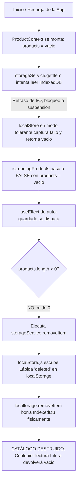

# Teoría Técnica del Autoborrado de Datos — POS Donde Juancho

Este documento detalla la investigación arquitectónica sobre el fenómeno de **desaparición recurrente de datos locales (productos, ventas y caja)** en la aplicación web / PWA de **Donde Juancho**, explicando su origen, el mecanismo exacto de falla y la solución permanente.

---

## 1. ¿Por qué está allí ese código? (Origen e Intención Original)

En [ProductContext.jsx](file:///c:/Users/luigg/Desktop/sistemas%20personalizados/donde%20juancho/sistema%20pos/projects/donde%20juancho/src/context/ProductContext.jsx#L358-L391), dentro del efecto de guardado automático (*auto-save debounce*), se encuentra este bloque:

```javascript
// ProductContext.jsx (Líneas 364-390)
savePromises.push(withLock('pos_write_lock', async () => {
    if (products.length > 0) {
        ...
        await storageService.setItem('bodega_products_v1', productsForSave);
    } else {
        await storageService.removeItem('bodega_products_v1'); // ⚠️ EL DETONANTE
    }
}));
```

### ¿Cuál fue la intención del desarrollador?
1. **Patrón CRUD genérico mal aplicado:** En aplicaciones simples (como listas de tareas o carritos de compra), es común la lógica: *"Si la lista tiene elementos, guárdala; si está vacía, borra la clave para no ocupar espacio en disco"*.
2. **Confusión entre "Catálogo Vacío" y "Borrado del Catálogo":** El desarrollador asumió que si el arreglo `products` en memoria tenía tamaño `0`, era porque el usuario había decidido vaciar la tienda por completo.
3. **Redundancia peligrosa:** La interfaz ya cuenta con un botón explícito de borrado en [ProductsView.jsx](file:///c:/Users/luigg/Desktop/sistemas%20personalizados/donde%20juancho/sistema%20pos/projects/donde%20juancho/src/views/ProductsView.jsx#L1221-L1224) que exige escribir la palabra `"BORRAR"`. Incluir un `removeItem` reactivo y automático dentro del ciclo de renderizado de React fue un **antipatrón de diseño crítico**.

---

## 2. ¿Por qué es la razón del problema? (Mecanismo y Condiciones de Carrera)

La desaparición de los datos **no ocurre por un borrado deliberado del cajero**, sino por una **cadena reactiva destructiva** que convierte un retraso de milisegundos en una eliminación permanente.

### Diagrama del Ciclo de Destrucción



### Los 3 Eslabones de la Falla:

#### Eslabón 1: El modo `tolerant: true` en la lectura inicial
En [storageService.js](file:///c:/Users/luigg/Desktop/sistemas%20personalizados/donde%20juancho/sistema%20pos/projects/donde%20juancho/src/utils/storageService.js#L22-L25):
```javascript
getItem(key, defaultValue = null) {
    return localStore.getItem(key, defaultValue, { tolerant: true });
}
```
Y en [localStore.js](file:///c:/Users/luigg/Desktop/sistemas%20personalizados/donde%20juancho/sistema%20pos/projects/donde%20juancho/src/utils/localStore.js#L296-L298):
```javascript
if (errors.length && !tolerant) throw new StorageReadError(key, errors);
if (errors.length) console.warn(`[Storage] Lectura incompleta de ${key}:`, errors);
return defaultValue; // Retorna [] silenciosamente
```
Si IndexedDB tarda en responder (por ejemplo, al reactivar la laptop tras suspensión o por lentitud de disco), el sistema **no espera ni lanza error**: asume que la base está vacía y devuelve `[]`.

#### Eslabón 2: El disparo del Auto-Guardado en `products.length === 0`
Al recibir `[]`, el componente cree que la carga terminó exitosamente y pone `isLoadingProducts = false`. Inmediatamente se dispara el `useEffect` de auto-guardado, entra al bloque `else` y llama a `removeItem('bodega_products_v1')`.

#### Eslabón 3: La "Lápida de Muerte" (*Tombstone*) en `localStorage`
En [localStore.js](file:///c:/Users/luigg/Desktop/sistemas%20personalizados/donde%20juancho/sistema%20pos/projects/donde%20juancho/src/utils/localStore.js#L309-L317):
```javascript
async function removeValue(key) {
    // Graba un sobre durable indicando que la clave fue borrada deliberadamente
    writeRecord(key, null, 'deleted');
    await localforage.removeItem(key);
}
```
Al grabarse el registro `kind: 'deleted'` en `localStorage`, la app queda **mutilada permanentemente**: aunque el usuario refresque la página o reinicie la máquina, `readValue()` lee la lápida `deleted` y siempre retornará `[]`.

---

## 3. Factores Agravantes: Entorno y Hardware

Además del bug en el código, existen factores de Chrome y Windows que disparan el problema con frecuencia:

| Factor de Entorno | Mecanismo de Impacto |
| :--- | :--- |
| **Falta de `navigator.storage.persist()`** | El código no pide almacenamiento persistente. Chrome marca los datos como temporales (*best-effort*). Si el disco `C:` baja del 10% de espacio libre, Chrome purga IndexedDB sin avisar. |
| **Revocación de Monitor (`wipeMonitorSession`)** | En [useSupervisorCommandQueue.js](file:///c:/Users/luigg/Desktop/sistemas%20personalizados/donde%20juancho/sistema%20pos/projects/donde%20juancho/src/hooks/useSupervisorCommandQueue.js#L413), al recibir un evento de revocación de sesión, ejecuta `await localStore.clear()`, borrando toda la base local de esa máquina. |
| **Arquitectura *Push-Only* (Sin Auto-Pull)** | En [useCloudSync.js](file:///c:/Users/luigg/Desktop/sistemas%20personalizados/donde%20juancho/sistema%20pos/projects/donde%20juancho/src/hooks/useCloudSync.js#L651), la caja principal **solo sube datos**, nunca descarga de la nube al iniciar. Si su almacenamiento local se vacía, queda huérfana en 0 y requiere un archivo JSON manual. |

---

## 4. Plan de Solución Definitiva (Sin Efectos Secundarios)

Para erradicar la necesidad de restaurar por JSON para siempre, la solución consta de 4 defensas:

### 1. Eliminar la Rama Destructiva en `ProductContext.jsx`
```javascript
// SOLUCIÓN:
if (products.length > 0) {
    await storageService.setItem('bodega_products_v1', productsForSave);
}
// NUNCA llamar a removeItem en auto-guardado. Si products está vacío, NO SE TOCA EL DISCO.
```

### 2. Guardrail contra Borrado de Colecciones Críticas en `storageService.js`
Impedir que `removeItem('bodega_products_v1')` o `removeItem('bodega_sales_v1')` se ejecuten salvo que exista un flag explícito de confirmación administrativa (`confirm_bulk_delete_catalog_flag`).

### 3. Blindaje de Persistencia ante el Navegador
En la inicialización de la app (`App.jsx` o `storageService.js`), solicitar persistencia protegida:
```javascript
if (navigator.storage && navigator.storage.persist) {
    const isPersisted = await navigator.storage.persist();
    console.log('[Storage] Persistencia blindada:', isPersisted);
}
```
Esto le prohíbe a Chrome desalojar los datos aunque el disco tenga poco espacio.

### 4. Rutina de Auto-Sanación (*Self-Healing Cloud Pull*)
En `useCloudSync.js`: si la caja arranca y detecta que `bodega_products_v1` o `bodega_sales_v1` están vacíos en local, pero en Supabase existen registros para esta institución:
* **Descargar automáticamente el catálogo y las ventas de la nube en segundo plano**.
* La app se restaura sola en 2 segundos sin que el usuario tenga que pedir un archivo JSON ni intervenir manualmente.
